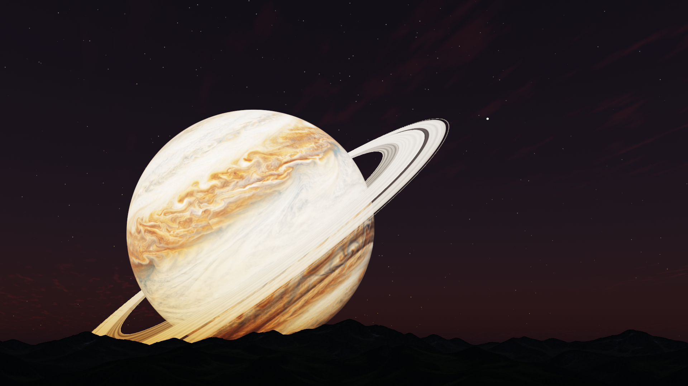

# Gas Giant Observatory

A smooth three-day flight across oceans, forests and mountains on a synchronously rotating moon.

Move the cursor into the upper-right corner to reveal **Open debug menu**,
then click it. This works in the standalone preview and the native lock screen.
Use **X** to close the menu, or launch the preview with `--debug` to open it
immediately. The time slider offers day, three-day flight and year ranges; drag
and release to fast-forward the whole scene. In the preview, Space pauses/resumes,
Home resets the range, and Left/Right step time. On the lock screen, keyboard
input remains exclusively for authentication; use the menu's mouse controls.

**Weather** offers Auto, Clear, Fair, Overcast, Fog and Storm. Auto restores the
current biome's evolving weather. Overrides preserve wind and cloud motion and
feed the same cloud, ground-shadow, reflection, precipitation and lightning
rendering. Fog is usually below the aircraft; storms can obscure the giant.
These are temporary, per-window/output controls, reset when the screensaver
restarts. The airborne weather path must be enabled (not `--fixed-view` or
`--no-weather`). The meteor section offers **Auto**, **Preview now** and **Off**. Auto schedules
short showers at deterministic random intervals of 1–8 real hours (mean 4.5),
lasting 6–16 minutes. Some are hidden by daylight, the radiant's position or
weather. The frequency slider sets .5–60 bright visible-field candidates per minute;
its normal setting is 3. Preview now starts a stream immediately, with its first
meteor after about half a second, provided the sky is dark. Daytime previews show
**Waiting for dark sky**. These are compressed fictional shower encounters, not
Earth's annual shower calendar. Meteor motion is in real seconds, independent
of the accelerated celestial rotation.

Meteors occupy a 105–115 km ablation shell, move at 26–68 km/s with a shared
inertial radiant, and have exposure-integrated luminous heads, brief wakes and
occasional weak wind-sheared ion trains. Color stays near white; brightness uses
the catalog-star magnitude zero point. The modeled population is magnitude +2
or brighter; the rate applies to that bright population, with faint dust omitted. The normal atmosphere, cloud extinction,
terrain occlusion, HDR composition and water reflection paths apply. The model
importance samples the visible atmospheric field; it is a visual approximation,
not an ablation-fluid simulation. Speeds, short durations, emission colors and
ion-train behavior are informed by the [American Meteor Society's fireball
FAQ](https://www.amsmeteors.org/fireballs/faqf/). No photos, particle textures,
fullscreen effect pass or additional render target are needed. Inactive effects issue no GPU work; a small shader and vertex buffer are created
lazily for the first active batch and then reused. See [meteor rendering and
review commands](docs/METEORS.md).

For a reproducible preview, use `--meteor-mode preview --meteor-rate 30`.
`--meteor-preview-start SECONDS` fixes the stream epoch for captures/recordings;
`--meteor-mode off` restores a meteor-free reference.

Hidden menus issue no extra GPU draws or allocations. Native
pointer controls require `general:hide_cursor = false`, as in the shipped config.

A large gas giant hangs above the mountains while twenty eccentric moons move
through a shared 3D system. Slender, translucent ice rings share the giant’s
tilted equator. Sunlight, phases and eclipse shadows follow that
geometry. The sky changes through a 30-minute solar day, with biome-dependent drifting
cloud banks, occasional storms, and stars emerging at dusk.

## Biome weather beta

`feat/weather-integration` combines altitude-aware cloud banks, high cloud, valley fog,
distant precipitation and local intracloud lightning. Weather evolves independently
of the solar day and responds to regional climate. Fair weather usually leaves
the giant visible; occasional tall storms can obscure it. The cloud field also
supplies ground shadows and water reflections. The integration branch includes
the native timer, terrain CPU optimizations, cooperative background mesh building
and a same-frame optical cache for smooth sky clouds. See the
[integration review and validation](docs/WEATHER_INTEGRATION.md). Operator review
is required before merging. Coastal rendering optimizations, measured budgets
and NixOS installation preparation are tracked in the
[coastal follow-up](docs/COASTAL_WEATHER.md).
See [weather behavior, rendering and review commands](docs/WEATHER.md).

## Reviewed landscape fidelity

The merged landscape fidelity work adds coherent alpine/canyon/coastal terrain, cached
physical materials, dense crown shading, filtered water glints, wet shores and
optional coarse coastal terrain reflections. Thin clouds have shared lighting, shadows
and reflected coverage. Geometry streams in bounded uploads without replacing
a partially drawn mesh. See [landscape design](docs/SURFACE.md) and
[Phase 2 scope and validation](docs/LANDSCAPE_PHASE2.md).

To preview the reviewed landscape without weather:

```sh
nix build github:mkaszynski/gas-giant-screensaver/d5fc3d572f91f83e1c46dcab26cdffa8db16c491#gas-giant-screensaver -o result-landscape-phase2
./result-landscape-phase2/bin/gas-giant-screensaver --data-dir ./result-landscape-phase2/share/gas-giant-screensaver --fullscreen --debug --fps 30 --time 900 --travel-time 162000
```

Explicit packaged data prevents an older executable loading shaders from a
newer working directory. The target is 30 fps at 1080p within 30% additional
complete-renderer cost versus Phase 1. The [landscape PR](https://github.com/mkaszynski/gas-giant-screensaver/pull/12)
is merged; the NixOS source pin is unchanged. Frame stalls remain tracked in
[issue 13](https://github.com/mkaszynski/gas-giant-screensaver/issues/13).

## Earth sky and Milky Way

The renderer uses Earth's J2000 sky: 8,920 catalog stars with measured
magnitudes and color indices, plus modeled Milky Way light and measured dust lanes.
Coordinates and colors are baked once; one cached cubemap sample in the existing
sky pass supplies the diffuse galaxy. Local atmosphere, clouds, mountains and
celestial bodies determine visibility. A brightly illuminated giant suppresses
the faint sky; total eclipse is a useful review instant.

The current revision generates the Milky Way from stellar-emissivity integration
and measured all-sky/local 3D dust extinction. Individual catalog stars remain
sharp; unresolved starlight is a continuous field. No RGB sky photo, NASA raster
or 8-bit intermediate supplies the model. The cached 2048-pixel HDR cube uses
about 32 MiB with hardware BC6H compression and one lookup per sky pixel.
Expensive integration runs offline, never during animation. The model's stellar
populations and distant dust are approximations, described in the design notes.

Preview the merged galaxy version without changing the installed screensaver:

```sh
nix run github:mkaszynski/gas-giant-screensaver -- \
  --fullscreen --time 437625
```

From this checkout, `nix run . -- --fullscreen --fixed-view --time 437625` builds the current
branch. For a frozen review image:

```sh
nix run . -- --capture galaxy.png --fixed-view --time 437625 --width 1920 --height 1080
```

Compare with `--no-galaxy`, `--no-stars`, or both. See
[sky sources, calibration, efficiency and limitations](docs/GALAXY.md).

[Eclipse sky capture](docs/images/galaxy-eclipse.png) ·
[Sky beside the sunlit giant](docs/images/galaxy-night.png)



[Animated preview](assets/preview.webp) · [MP4](assets/preview.mp4) · [Daylight](assets/preview-day.png) · [Eclipse](assets/preview-eclipse.png)

## Run on NixOS / Hyprland

```sh
nix run github:mkaszynski/gas-giant-screensaver -- --fullscreen
```

Press **Escape** or **Q** to close. The preview does not lock the desktop.
It caps rendering at 30 fps and stops when Hyprland reports a display powered
off. Use `--fps 15` for a lower frame budget, or `--timeout 20` for a brief preview.

From a checkout:

```sh
nix run . -- --fullscreen --timeout 20
```

## Native lock screen

The optional package uses Hyprlock's native session lock and PAM authentication.
It retains the cyan password segments, Orbitron status text, red failure halo,
three-second failure hold, and 800 ms deceleration plus 1000 ms unlock fade of
the Hyperspace Starfield setup. Rendering pauses when the compositor stops
sending frames to an inactive output.

Validate the config without locking:

```sh
nix run .#gas-giant-lock -- --check-config
```

Activate the actual lock (unlock with your normal account password):

```sh
nix run .#gas-giant-lock
```

For Home Manager, add this repository as a flake input, select
`inputs.observatory.packages.${pkgs.stdenv.hostPlatform.system}.hyprlock-observatory`
as `programs.hyprlock.package`, and use `hyprlock/observatory.conf` as the lock
configuration. NixOS needs `security.pam.services.hyprlock = {};` as usual.
Installing the preview does not change any host configuration or idle timeout.

## Appearance and geometry

- Giant: Jupiter radius, three Jupiter masses; solar-size star at about 1 AU.
- Observer orbit: semimajor axis **three giant radii**, eccentricity **1/9**.
  Apocenter is exactly **25% farther** than pericenter.
- The observer moon has Earth's **6,371 km radius**. The other nineteen moons
  retain **three times their initial radii**; the largest is about three Earth
  radii. This is a fictional, artist-directed system.
- Observer orbit: **10° inclined to the giant’s equator**. Other moon planes
  span **1–10°** from that same equator, with different nodes.
- A closed circuit across the Jupiter-facing hemisphere takes **72 real hours**,
  crossing latitudes up to **59.5° north/south**, with a smooth, hill-anticipating altitude profile **at least 600 m above
  ground or water**, without sideways detours or ground-following bobbing. Mean synchronous rotation preserves orbital libration.
  `--fixed-view` retains the original 38° N, 50° observer for comparisons.
- Twenty moons includes the observer moon. Visibility and apparent size follow
  geometry; the renderer does not arrange all nineteen others in the frame.
- Rings: **1.235–1.780 giant radii**, with narrow bands and a Cassini-like gap.
  Their plane and the giant’s texture share a **26.7° tilted pole**. Optical
  depth varies by radius and viewing angle; moons remain visible through
  thinner bands. Planet/ring and moon/ring shadows work in both directions.
- Faint nighttime airglow and ambient mountain light preserve subtle detail.
- Finite solar disk (about 0.53° across), atmospheric aureole, soft optical glare,
  mutual eclipses, and planetshine approximation.
- Moving spherical terrain with ocean, sea ice, snowy uplands, drylands, grassland
  and forests; connected measured ridges and valleys with cached surface normals and skylight occlusion,
  continuous overlapping forest canopies, cloud/terrain shadows and
  multisample silhouettes. See [surface circuit](docs/SURFACE.md). The previous
  fixed alpine landscape remains available with `--fixed-view`.
- Generated gas giant band texture; runtime
  lighting supplies their changing appearance. Mountain interiors fully occlude
  the sky, with antialiasing restricted to the silhouette.

## Gas giant atmosphere

The giant has a thin, physically scaled hydrogen/helium atmosphere above its
cloud deck. A 280 K reference temperature, mean molecular mass of 2.3 atomic
mass units and this giant’s gravity give a **13.6 km scale height**. Molecular
scattering favors blue wavelengths; a very faint, nearly neutral haze adds
forward scattering. The chosen temperature, 0.1-bar cloud-top pressure and haze
are plausible parameters for this fictional warm giant, not measurements of an
Earth-distance Jupiter. Solar illumination uses the same normalization as the
clouds and rings: there is no special eclipse brightness boost.

The atmospheric arc is most distinctive close to eclipse contact. It responds
to the finite Sun, the giant’s own shadow, moon shadows and translucent ring
shadows. At this close observer distance a central eclipse can hide the entire
sunlit atmospheric limb; a glowing ring throughout totality is not imposed.
The ordinary day/night appearance changes only subtly.

[Actual eclipse-contact capture](assets/preview-atmosphere-contact.png)

```sh
nix run . -- --fullscreen --fixed-view --time 376368
```

A small static lookup and a narrow, antialiased limb integration keep the cost
bounded. There is no atmospheric bloom or enlarged glowing shell. This is a
single-scattering approximation; atmospheric refraction and multiple scattering
inside the giant’s atmosphere are not simulated. Details and numerical checks:
[design](docs/DESIGN.md#gas-giant-atmosphere) and [validation](docs/VALIDATION.md#gas-giant-atmosphere).

## Performance

The renderer is C++20 / OpenGL ES 3.0. A cached transmittance table and an
isotropic multiple-scattering table feed a small sky lookup texture. Only the
sky table changes during the day. Sphere draws are bounded to screen rectangles;
impossible shadow casters are rejected on the CPU. Weather integrates cached
cloud density at display resolution with a bounded sample count and a small
solar-transmission volume. `--no-weather` retains the thin-cloud path.
Solar glare adds no extra rendering pass. There is no runtime AI,
network access or per-frame asset texture upload.
The moving world streams bounded local geometry with one background worker;
shadow updates and multisample rendering are limited to the visible terrain.

Measurements and limitations: [validation report](docs/VALIDATION.md).
The [terrain build report](docs/TERRAIN_BUILD_COST.md) records exact geometry
comparisons, background CPU costs and frame-stall diagnostics.
The frame cap and output suspension matter more for power than peak FPS.

## Build and test

```sh
nix develop
cmake -S . -B build -G Ninja -DCMAKE_BUILD_TYPE=Release
cmake --build build --parallel
ctest --test-dir build --output-on-failure
./build/render-tests
./build/ring-render-tests
./build/edge-render-tests
./build/atmosphere-render-tests
./build/scattering-edge-tests
./build/emission-render-tests
./build/sky-render-tests
./build/terrain-render-tests
nix flake check
```

Use `--no-rings` for a direct visual or performance comparison.

GPU tests need a display and GLES 3. CI runs them using Mesa llvmpipe and Xvfb.
They check opaque mountain occlusion, deterministic resize, visible bodies,
and day/night contrast. Unit tests verify orbital geometry and eclipse cases.

Capture and measure the real renderer:

```sh
nix run . -- --capture twilight.png --time 1180 --width 1920 --height 1080
nix run . -- --benchmark 180 --time 900 --width 1920 --height 1080
```

The separate [native cadence tool](docs/FRAME_PACING.md) measures packaged
Hyprlock surface submissions on an owned headless output. It does not measure
physical presentation.

`--time` sets the starting scene time in seconds; `--capture` freezes it.
Normal launches use continuous Unix seconds (since 1970-01-01 UTC), then advance
with a monotonic clock. Restarting resumes the same celestial timeline. There
is no global loop: the moons, giant rotation and stellar year have different
periods. `--day-seconds` changes the speed of the system. At the default 1800-second
solar day, one complete stellar year takes about **20.52 real days**, not 365
moon days (7.60 real days). Clouds wrap each texture octave seamlessly in double
precision before uploading small offsets to the GPU.

This corrects the former startup reset at 365 moon days, which skipped about
63% of the year; upgrading changes the current celestial phase once. Previously
published wall-clock eclipse dates no longer apply. Explicit `--time` review
instants retain their orbital geometry. See `--help` for recording options.

## Lightning and auroras

Water-cloud thunderstorms produce small, brief glows on the giant. Flash frequency and
duration follow the orbital simulation speed (about 17.8× at the default
30-minute day). Sub-frame pulses retain their energy through exposure integration.
Broad, pale lavender polar auroras use a deliberately brighter artistic style.
Their ribbons are eight times wider than the original thin arcs, with slow
undulations and drifting bright patches. Aurora brightness defaults to 1000×
the modeled baseline (200× the earlier brightness of 5); lightning remains at 5×.
Brightness scales emitted light before tone mapping; daylight can still wash
it out. Geometry, foreground moons, translucent rings, local clouds and
mountains control their visibility.

Adjust them independently without rebuilding:

```sh
./build/gas-giant-screensaver --fullscreen --time 437625 \
  --aurora-brightness 1000 --lightning-brightness 20
```

Both accept 0–1,000,000: `0` disables that effect, `1` is the modeled baseline,
with defaults of `5` for lightning and `1000` for auroras. Larger values brighten
the effect before tone mapping, without changing its size or timing. Restart the preview to change
values. In Hyprlock's `observatory` block, use `aurora_brightness = 1000.0` and
`lightning_brightness = 20.0`; their defaults are `1000.0` and `5.0`, respectively.

Use `--weather-time SECONDS` for a reproducible weather starting time, or
`--no-emissions` for a comparison. See [physical assumptions, sources and
rendering details](docs/EMISSIONS.md).

## Scope and provenance

This is a purpose-built screensaver, not an orbital habitability simulator.
Keplerian paths are prescribed; long-term N-body stability is not claimed.
The default landscape is a streamed procedural surface along a fixed airborne
route. `--fixed-view` retains the old stationary mountain layer.
Atmospheric eclipses use local visibility rather than a volumetric shadow
integration; overlapping penumbras use an approximation. See
[design](docs/DESIGN.md) and [asset provenance and prompts](docs/ASSETS.md).

## License

The original renderer is released under the standard [MIT License](LICENSE). Hyprlock integration incorporates BSD-3-Clause upstream
code and attributed UX patches. Generated assets: CC0-1.0 to the extent rights
exist. See [LICENSE](LICENSE) and [attribution](docs/ASSETS.md).
The HYG-derived star catalog has a separate CC BY-SA 4.0 data license; the modeled
Milky Way model cache uses CC BY 4.0 for its measured dust inputs. See
[sky attribution and included data license](assets/sky/ATTRIBUTION.md).
The optional portable BC6H decoder retains its upstream
[MIT notice](assets/sky/LICENSE-BCDEC-MIT.txt).
