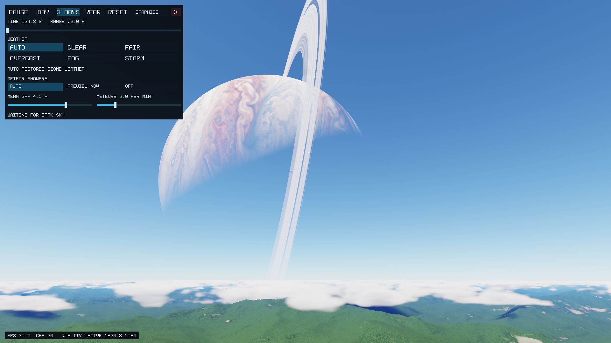

# Preserve collection headroom inside the resource envelope

A renderer's parallel startup compilation can consume a shared cgroup's whole
CPU quota and temporarily freeze its collector. A CPU-only four-worker
reproduction measured a 50.86 ms maximum collection pause with the standard
90% parent quota. Giving the renderer a stricter `4000 5000` child quota and
leaving the collector in a sibling group reduced the pause to 2.85 ms. The
parent remained `90000 100000`; memory, swap, time and task limits were not
raised. This is a measurement-infrastructure fix, not a rendering speedup.

`browser_budget.py --delegate-cpu` permits CPU subgroups in its owned transient
unit. It does not change default limits or automatically move a command to a
subgroup. Collection code must keep every child inside the bounded parent,
apply identical child limits to compared applications, preserve all workload
controls, and retain failed runs. Unsupported delegation fails without an
unbounded retry. The default browser/software-check path is unchanged.

## Application validation at `5bf5c20`

The [numeric report and compressed frame traces](frame-drop-investigation/5bf-validation/summary.json)
retain the frozen Phase 1 comparison and the long native flights. No clock,
governor, resolution, scene effect, sample count or terrain detail was reduced.

- All 12 frozen-cost runs and six matched pairs pass the original controls.
  The largest current/reference median ratio is 1.093 and p95 ratio is 1.058,
  below the unchanged 1.30 limit. Cost uses every recorded frame, including
  startup, with the established legacy-cloud isolation for landscape cost.
- Four individual current full-weather forest/coast flights have zero missed
  deadlines in 2,840 steady frames. Their workload controls pass; observed
  steady throughput is 29.9997–30.0002 fps. The largest p95 render cost is
  27.655 ms. Only the first ten frames of each flight are excluded from steady
  deadline counts; median/p95 costs still include every frame.
- Each current flight completes four mesh revisions; normal transfers remain
  bounded to 2 MiB. The complete native preview's process-tree RAM peak is
  258.7 MiB, measured separately from GPU residency.
- Both renderer jobs, both Nix jobs, WebGL/WebGPU/fallback/native parity, and
  the full browser memory matrix pass at this application revision. All 45
  compute/reference and 30 specialization images have zero differing display
  codes on the software renderer. This does not substitute for hardware fps.
- The original full-weather comparative trial remains invalid: its first
  reference exceeded the 10 ms collection bound at 11.47 ms. That trace is
  retained alongside the seven remaining planned samples. No comparative
  speedup is inferred from this invalid trial.

A fullscreen hardware preview displayed native 1920×1080 at 30.0 fps:

These results establish the stated native sample results and frozen landscape
cost allowance. Browser hardware fps remains unverified. Operator review is
still required before merge or a NixOS pin update.
