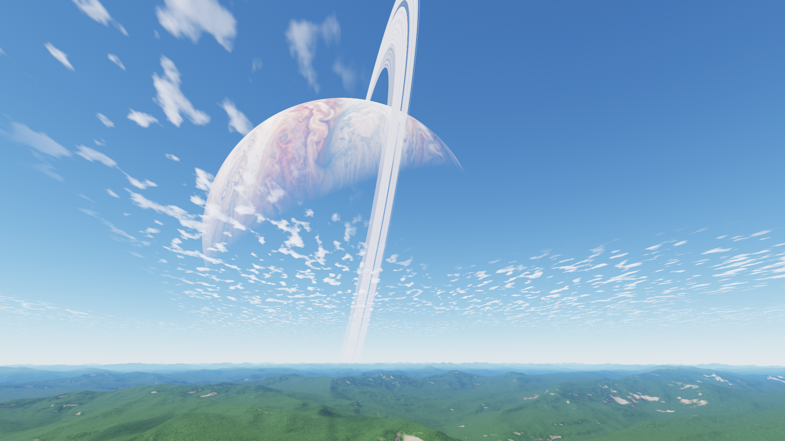
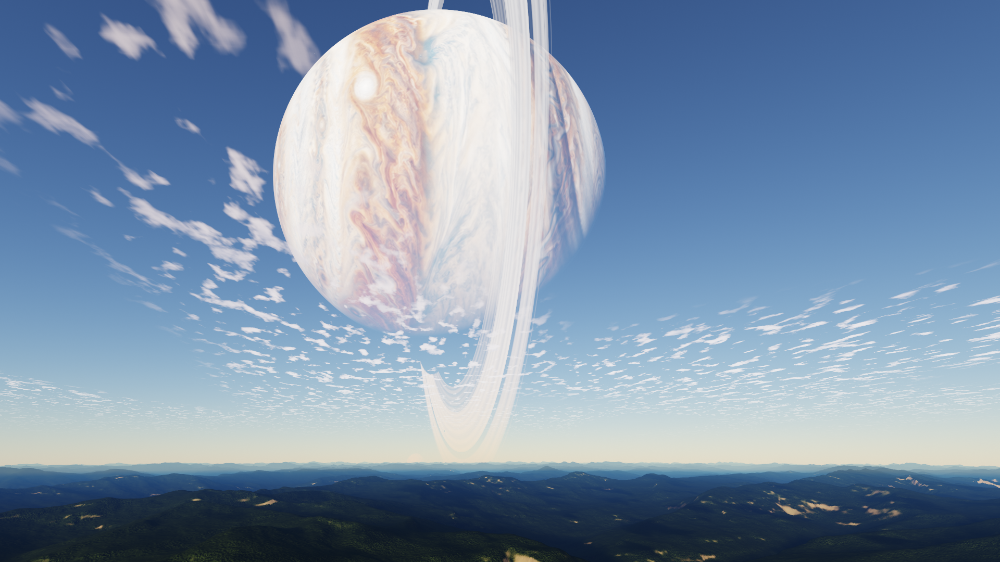
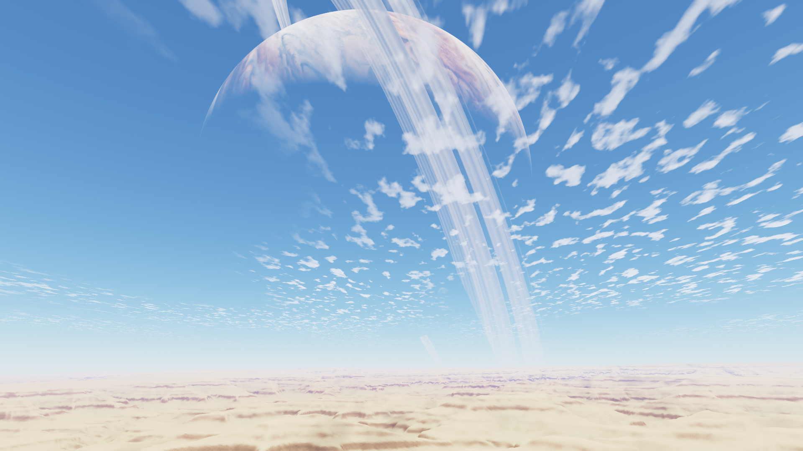
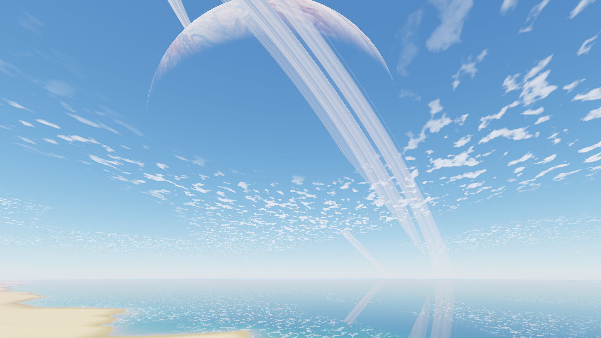

# Three-day flight over the moon

The default preview and native Hyprlock widget fly over an Earth-size moon.
The closed route is a constant-speed small circle 59.5 degrees from the mean
subplanet point, entirely on the Jupiter-facing hemisphere. It crosses
59.5 degrees north and south, forests, grasslands, drylands, tundra, snowy
uplands, coasts, open water and sea ice. One circuit takes **259,200 real seconds
(72 hours)**. Its approximately 34,500 km length gives about 133 m/s ground speed.

This is an airplane-height flight. There are **no sideways terrain detours**,
and the camera does not follow every ground bump. A cached altitude envelope
anticipates hills, stays at least 600 metres above the terrain, and limits
normal climb/descent to 3.5 m/s. Over valleys it can be higher. A periodic cubic
B-spline makes altitude, velocity and acceleration continuous at the loop.

The flight clock is independent of the accelerated astronomical clock. Default
startup uses Unix time; opening another preview resumes the world's journey.
Only the route phase wraps, never the astronomical year. The camera faces the
mean subplanet meridian rather than chasing accelerated orbital libration.
Jupiter moves naturally within the frame and remains visible through the route.
Large rings can extend outside the frame. Its physical size and orientation
are preserved.

## Camera, terrain and lighting

The same geographic position and flight altitude feed terrain, celestial
parallax, eclipses, atmospheric scattering and clouds. Geographic north is
corrected at the boundary to the legacy astronomical frame; east follows the
moon's prograde rotation. Viewing elevation is 19 degrees with the existing
58-degree vertical field of view. There is no walking animation or camera roll.

A cached 2048×1024 continental field supplies heights, moisture and mountain
uplift. Three connected 32 km relief fields at 16 m spacing provide alpine
Swiss/Skadi ridges and valleys, Colorado Plateau canyon drainage and Pacific
Northwest foothills. Biome weights blend their geometry and lighting together.
Periodic-plus-smooth boundary correction removes tile-edge mismatches; mild
coordinate warping avoids superimposing incompatible mountain shapes. These
are reusable numerical landforms on a fictional moon, not surveyed continents.
Climate is an idealized annual Earth-like model based on latitude, altitude and
moisture; it is not coupled hydrology or seasonal vegetation simulation.
See [world credits](../assets/world/ATTRIBUTION.md) for sources and modifications.
No photographic landscape or vegetation inputs are used.

Each relief field has cached full-resolution normals, valley/crest curvature and
terrain skylight occlusion. The three-layer lighting array occupies **64 MiB**
including mips. Usually one or two active layers are sampled; pure water skips
these fields. Six 512² material layers provide linear albedo, roughness,
height-derived normals and cavity occlusion for rock, grass, sand, tundra, snow
and soil. Their two texture arrays total **16 MiB** with mips. Soil gathers in
humid valleys; regional rock tint and filtered sediment bands distinguish arid
cliffs. Only materials with nonzero weights are sampled.

Forests form a continuous canopy volume with touching crowns, rather than
widely separated dots. A 1024² numerical field mixes lobed broadleaf crowns and
tapered conifers, with height-derived normals and cavity occlusion. An additional
eight-direction field stores visibility at four solar elevations. Its **10.7 MiB**
mip chain averages visibility after geometric occlusion, preserving small tree
shadows when crowns become subpixel. Two filtered forest-only lookups interpolate
azimuth and elevation continuously. Individual branch geometry is not rendered
at this airplane height. Fine detail remains filtered and geographically anchored.

Direct light uses atmospheric solar transmission, predicted terrain shadows,
cloud attenuation and eclipses. Materials use dielectric GGX reflection and
energy-conserving diffuse response; normal variation broadens distant highlights.
Skylight uses a two-direction hemisphere approximation and cached occlusion.
Directional, nearly white planetshine illuminates nighttime terrain. Thin-leaf
lighting is directional and cannot emit through an eclipse or at night. Aerial
transmission uses the atmosphere's Rayleigh/Mie coefficients and height densities.

The same curved thin-cloud field supplies sky coverage, ground shadows, solar
halo attenuation and water reflections. Grazing paths increase cloud opacity;
coarse self attenuation and bounded forward brightening give depth without a
volumetric ray marcher. Twilight color comes from atmospheric solar transmission.
Explicit unwrapped texture gradients prevent modulo boundaries selecting wrong
mip levels. This is a thin-sheet approximation, not simulated cloud volume.

## Rendering bounds

A spherical radial mesh holds **512,800 vertices and 3,072,000 indices**, covering
145 km. Of 800 angular samples, 768 cover the forward 120-degree sector and 32
cover the back sector for shadow casters. Most of the 640 radial intervals
resolve the visible 1.5–45 km slopes; only 32 cover the ground beneath the
observer and 64 cover the hazy outer band. At 3.5 km, radial spacing is about
22 m instead of 44 m in the previous beta; angular spacing improves 1.5×.
Double precision precedes conversion to local GPU coordinates.

The mesh is divided into 3,200 conservative blocks with contiguous index ranges.
Camera and shadow frusta reject whole invisible blocks and coalesce adjacent
visible ranges into draws. This never rebuilds indices or uploads new buffers
per frame. Hardware/software comparison tests require pixel-identical output
with culling disabled in daylight, sunset and night. Warm deep-water blocks (every vertex below −64 m) use coarser
interior triangle fans. Their boundary uses every fine vertex and edge, so land
and water remain watertight. The fixed water index buffer uploads once;
coastlines, terrain shadows and all land retain the fine mesh. The GPU water
suite compares this LOD with the full mesh in daylight and night.

Area-weighted vertex normals retain continental curvature and the canopy.
The full 16 m measured relief gradients come from the existing filtered texture
arrays, giving smaller gullies consistent lighting independently of mesh LOD.
Measured slopes are excluded from vertex normals to avoid counting them twice.
No extra runtime height queries or additional texture arrays are needed.

One background worker replaces geometry after 750 m of flight. Normal frames
retain the complete old mesh while the replacement uploads into an inactive
buffer, at most **2 MiB per normal frame**. Geometry, bounds and the shadow frame
switch together only after the upload completes. Initial loading and
explicit jumps over 2 km build synchronously. Both vertex buffers retain
capacity; unchanged triangle topology uploads once. There is no runtime route
search, horizon scan, network access or GIS dependency.

Two cached 2048-pixel shadow cascades cover 8 km and 60 km extents. Each holds
a current and an astronomically predicted future depth map. Shadow visibility
blends smoothly between those states, then reuses the future map as current
without changing its depth pixels. The hidden old map is recycled for the next
prediction. Near/far updates are staggered: normally only one depth map updates
on a given frame, at 1/2-second intervals under a high sun and 0.5/1-second
intervals near sunrise/sunset with the default 30-minute day. Cadence scales
with the configured day length. Large debug seeks rebuild both pairs once.
Direct sunlight, cloud shadows and eclipse visibility still use current time.
Receiver-plane bias and raster slope offset suppress self-shadow stripes.
All four shadow projections retain their physical world positions across mesh
uploads. A stable distance-based cascade transition avoids projection rollover
seams. Most land pixels use only one cascade, retaining eight PCF taps despite
the temporal blend; the narrow cascade transition samples both. The two extra
depth maps add about **32 MiB** of GPU storage (typical 4-byte depth allocation).
Entirely open-water meshes skip these shadow updates, and pure water pixels
skip land material and lighting work.

Up to 4x multisample HDR coverage is resolved before exposure/tonemapping.
Cached conservative bounds for 3,200 terrain blocks replace per-frame projection
of every vertex. A conservative screen bound crops storage and resolve to terrain pixels, with
quantized capacity to avoid reallocating for individual rows. Opaque terrain
occludes celestial objects and solar glare; only silhouettes
blend coverage. The old 88 MiB angular landscape cache is not loaded in flight.

Coastal terrain reflections are an opt-in prototype (`--terrain-reflections`):
the measured extra pass exceeded the complete-renderer budget. Normal rendering
retains reflected sky, celestial bodies and clouds without that terrain pass.

Ocean shading includes Fresnel sky/celestial/cloud reflections, depth-dependent
water color and four wind-wave scales with deep-water dispersion. Footprint
filtering removes unresolved wave normals and transfers their variance into
roughness. The solar disk is integrated through the filtered water BRDF rather
than counted again as a sharp reflected disk. Wet shores darken and smooth the
land material. Reflections sample clouds from the actual water position; the
base sea normal follows spherical curvature instead of coastal land slopes.

Near coasts, a quarter-resolution view renders **64,000 triangles** from the resident
terrain mesh. It uses a local planar mirror camera, with 1.5× field-of-view
overscan and confidence fades at image edges. The pass reuses cached shadows
and current lighting, updates every frame, discards liquid surfaces and avoids
framebuffer feedback. Its color/depth targets use roughly **1.5 MiB** at 1080p.
Open-ocean and inland meshes skip the pass. This is a coarse planar approximation
to a curved ocean, not full ray-traced reflections; outside-view celestial
reflections fall back smoothly to sky. `--no-terrain-reflections` disables the
pass for comparison. **Inland lakes/rivers, surf foam and coupled seasonal
climate remain outside this version.** The legacy fixed view retains its lake.

Phase 2 is a fidelity beta. The release target is 30 fps at 1080p within 30%
additional complete-renderer cost versus frozen Phase 1; 60 fps is a later goal.
See [phase scope](LANDSCAPE_PHASE2.md) and [validation](VALIDATION.md) for measured
limits. Operator review precedes merging or changing the NixOS source pin.

## Preview and reproduce

```sh
nix build .#gas-giant-screensaver -o result-surface
./result-surface/bin/gas-giant-screensaver \
  --data-dir ./result-surface/share/gas-giant-screensaver \
  --fullscreen --time 900 --travel-time 162000
```

`--travel-time` selects a route position without changing sky time.
`--travel-speed` changes the rate for review; default speed 1 completes the
three-day flight. Previewing does not lock the desktop. Escape or Q closes it.
The old fixed alpine renderer is retained only for regression comparisons.

Add `--debug` to display a preview-only time slider. Select **DAY**, **3 DAYS**
or **YEAR** to choose the range, then drag and release to seek. The year range
uses the actual accelerated stellar-year duration, not a modulo of the day.
Switching ranges starts a new window at the current instant. **PAUSE/PLAY** or
Space stops/resumes time; **RESET** or Home returns to the window's start;
Left/Right step by one-thousandth of the selected range. Releasing a drag seeks
once, avoiding repeated mesh rebuilds while moving the pointer.
The compact panel sits in the upper-left corner, leaving the landscape visible.

The slider advances the same absolute sky time used by the route, clouds and
weather, preserving any `--travel-time` or `--weather-time` starting offset.
`--travel-speed` still multiplies route travel. Epoch time is retained; only
each periodic subsystem reduces its own phase. Debug controls are excluded
from captures, recordings, benchmarks and the native lock widget. Ordinary
preview/lock rendering does not initialize or draw this overlay.

Offline regeneration uses pinned elevation downloads and Python requirements:

```sh
python scripts/bake_world.py --source /tmp/N46E007.hgt.gz \
  --swiss /tmp/terrain-swiss --output assets/world
nix develop --command cmake -S . -B build -G Ninja \
  -DCMAKE_BUILD_TYPE=Release -DOBSERVATORY_BUILD_FLIGHT_BAKER=ON
nix develop --command cmake --build build --target flight-baker --parallel 3
python scripts/bake_flight.py --executable ./build/flight-baker --output assets/world
python tests/test_world_bake.py
```

The offline flight builder samples **2,097,152 terrain positions**, computes
an upper envelope with bounded slope, filters it, and validates interpolated
clearance, climb rate and Jupiter visibility before replacing the asset. The
32,768-point `GGFLY001` float-height cache is just **128 KiB**. Its periodic
B-spline lookup takes four cached values per frame. The manifest binds it to
both elevation caches with SHA-256. Rebuilding terrain requires rebuilding
this profile.

## Review captures

These are actual 1920x1080 framebuffer captures:

| Surface | Sky time | Route time | Capture |
|---|---:|---:|---|
| Ocean | 1740 | 0 | [Ocean](images/surface/ocean.png) |
| Drylands | 1710 | 16200 | [Drylands](images/surface/drylands.png) |
| Forest | 510 | 162000 | [Forest](images/surface/forest.png) |
| Forest, low sun | 900 | 162000 | [Low sun](images/surface/golden.png) |
| Snowy uplands | 360 | 210600 | [Snow](images/surface/snow.png) |
| Forest twilight | 960 | 162000 | [Twilight](images/surface/twilight.png) |

See [validation](VALIDATION.md) for automated checks and measured performance.

## Phase 2 resolution review

Actual unedited 1920×1080 renderer captures of the tuned profile:

| Forest daylight | Low sun |
|---|---|
|  |  |

| Arid terrain | Coast |
|---|---|
|  |  |

[Night terrain capture](phase2/forest-night.png). These are source-rendered
screenshots, not photographs or generated illustrations. The coastal capture
uses the normal profile, with terrain reflections disabled.
