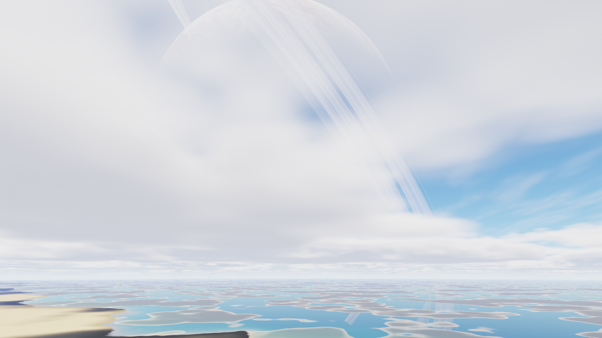
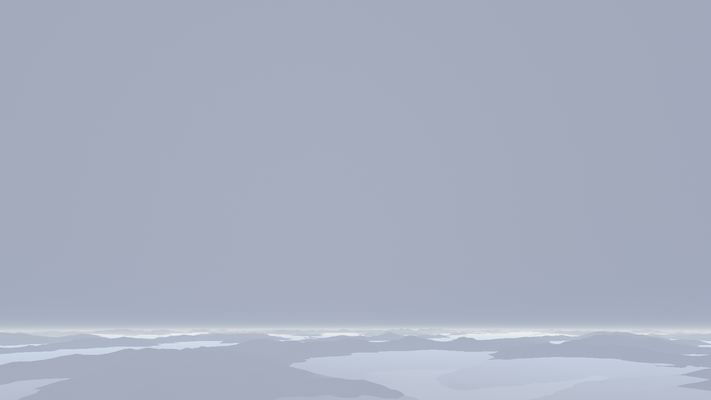
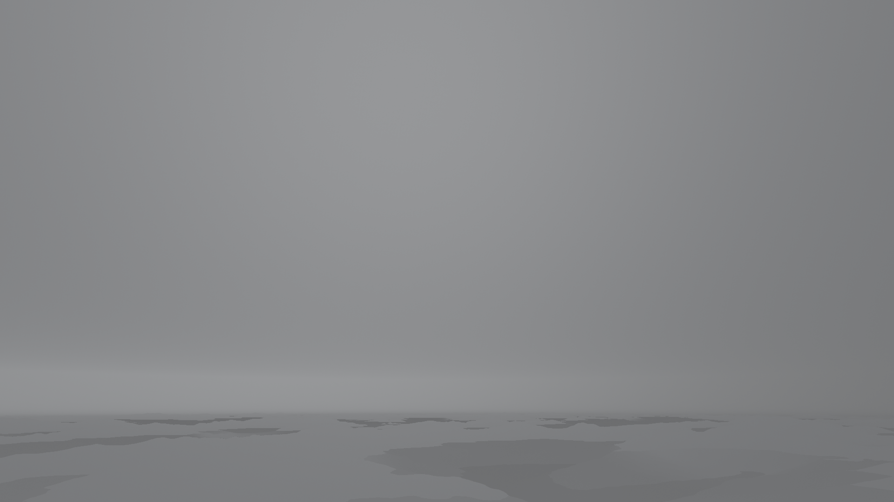

# Weather integration review

The review branch combines biome-dependent weather, the native frame-timer fix,
terrain CPU optimizations, cooperative mesh construction and smooth-sky cloud
reuse. Main and the installed NixOS source pin are unchanged. Review is tracked
in [PR 18](https://github.com/mkaszynski/gas-giant-screensaver/pull/18).

## Why the performance changes help

Background mesh construction previously consumed a continuous CPU burst on the
shared-power APU. Long frames occurred before upload, including frames with no
upload at all. Merely limiting upload bytes did not address that contention.
The worker now yields at bounded mesh-building checkpoints, allowing about 1 ms
of active work followed by 4 ms of sleep. Startup and large observer jumps remain
synchronous. The resident mesh covers ordinary flight while its replacement is
built. A regression test compares every vertex byte, index and bound with the
unpaced builder; geometry is unchanged. Streaming tests also exercise weather.

Three alternating 360-frame pairs, excluding the first ten frames of each run,
reduced forest deadline misses from 28/1050 to 2/1050. Median rendering cost was
20.81 ms before and 21.03 ms after; p95 improved from 26.41 to 24.19 ms.
The cloudy coast remained over budget in all 1050 steady frames with either
worker: median 38.73 ms before and 39.14 ms after. This distinguishes CPU
contention from the separate cost of integrating grazing cloud columns.

The low-cloud pass now builds a half-width, half-height optical cache each frame.
Only smooth sky regions reuse its bilinear radiance/transmission. Ground,
partially covered terrain, strong cloud transitions and bright unresolved sources
retain direct integration at display-pixel centres. High thin clouds, fog and
precipitation are evaluated at display resolution. Cloud noise and density LOD
still use display resolution, and the 12–48 quadrature range is unchanged.
The cache adds about 4 MiB at 1080p. There is no previous-frame history, jitter,
reprojection, delayed flash or stale lighting. `--no-weather-cache` provides a
reference path. This is a bounded approximation, not pixel-identical rendering.

The moving-cloud regression compares both paths over 48 frames each of forest
and coast, plus 24 lightning frames and an abrupt time/view change. It retains
all existing terrain opacity, MSAA, solar-cache and atmospheric tests.

## Reproduce the review

```sh
nix build .#gas-giant-screensaver -o result-weather-integrated
nix build .#hyprlock-observatory -o result-weather-integrated-lock
./result-weather-integrated/bin/gas-giant-screensaver --data-dir ./result-weather-integrated/share/gas-giant-screensaver --fullscreen --debug --fps 30 --time 510 --travel-time 162000 --weather-time 1790900000
```

These commands use the checked-out review branch. For a coast comparison, use
`--time 1740 --travel-time 5600.390625 --weather-time 1790900000` and optionally
`--no-weather-cache`. Explicit packaged data avoids mixing executable and shader
versions. Escape closes the preview. The preview does not lock the session.

The existing weather behavior and earlier landscape comparison remain documented
in [WEATHER.md](WEATHER.md). Rendering timers synchronize CPU/GPU work but exclude
physical presentation; native Wayland submission cadence also does not measure
scanout or establish a guaranteed physical-display frame rate.

## Combined validation

Measured renderer source: `e0f7171d73177e7d191ff290262cbc6ab844bde2`.
The before-cache reference is `0d78215`, which already includes worker pacing.
Both are Nix-built packages using their own packaged assets and shaders. The
AMD Renoir GPU ran with automatic clocks, one awake 1920×1080 desktop output,
and no real lock or Factory game observed before/after the measurements. Existing
compositor, browser and terminal clients remained active; exclusive GPU ownership
is not claimed. No local compilation, GPU test or other benchmark ran concurrently.

Three alternating pairs of 180 frames cover each view. The first ten frames of
each run are excluded below, leaving 510 steady frames per version/view; all
startup costs remain in the raw records. Animation uses elapsed wall time, so
slow runs cover longer intervals despite identical starting clocks and inputs.
These are whole-renderer streaming measurements, not fixed-pose kernel timings.

| View | Reference median ms | Cache median ms | Cache p95 ms | Reference misses /510 | Cache misses /510 |
| --- | ---: | ---: | ---: | ---: | ---: |
| Forest banks | 21.30 | 21.91 | 34.55 | 0 | 28 |
| Forest cumulus | 21.30 | 18.08 | 33.51 | 10 | 28 |
| Forest storm | 16.85 | 15.77 | 22.83 | 7 | 11 |
| Ocean | 25.33 | 21.91 | 24.48 | 17 | 0 |
| Snow | 18.98 | 19.82 | 28.13 | 67 | 16 |
| Cloudy coast | 39.78 | 40.88 | 50.79 | 510 | 510 |

The cache has mixed measured performance: several medians improve, while forest
banks, snow and coast regress slightly. It does not solve foreground cloud cost,
and the paired data do not establish a universal speedup. An earlier isolated
coast probe reached 25.65 ms median, but that result did not reproduce across this
series and is not the acceptance result. **The 30 fps rendering budget remains
unmet on the coast, with intermittent misses elsewhere.** This beta is ready for
visual review, not a claim that performance acceptance is complete. The original
Phase 1 1.30× landscape budget is not re-certified by this weather comparison.
Open performance work remains in [issue 13](https://github.com/mkaszynski/gas-giant-screensaver/issues/13)
and [issue 15](https://github.com/mkaszynski/gas-giant-screensaver/issues/15).

The separate 720-frame forest run completed four mesh revisions/five started
builds. Its 710 steady frames measured 21.81 ms median, 23.91 ms p95 and 31.88 ms
maximum, with zero missed deadlines. Peak process RSS was 306.64 MiB, excluding
some GPU residency. Normal uploads remained at most 2 MiB per frame.

The actual packaged Hyprlock renderer ran on a private 1920×1080, 60 Hz headless
output using the running desktop as renderer donor. After five seconds of warmup,
600 submissions over 20 seconds measured 30.001 submissions/s, 33.364 ms median
interval, 33.973 ms p95 and 49.903 ms maximum. There was no opaque fallback, and
the owned test lock exited cleanly. This measures submissions for the current
native view, not physical presentation or every weather condition. The real
session was never locked/unlocked by this test.

All 43 CPU/CLI tests, 38 offline content tests, seven profile-analysis tests,
six native-parser tests, 14 GPU test programs on AMD and all 14 on Mesa software
passed. Benchmark CSV checks passed on both renderers. `nix flake check`, both
package builds and the `implosion-screensaver` configuration check with a temporary
input override passed without changing the NixOS pin or lock file.

## Image review

Moving 640×360 reference comparisons peaked at 8/255 on both AMD and Mesa
software. Full-HD packaged snapshots compared with `--no-weather-cache` have
mean per-channel error below .021/255; the worst single channel differs by
14/255 on the coast. This bound describes the sampled views, not every possible
sky. The tested cache is a small optical approximation; geometry, terrain
coverage and high thin-cloud detail retain their original resolution.

| Forest banks | Coast |
| --- | --- |
|  |  |
| **Dense storm** | **Night intracloud flash** |
|  |  |

The captures retain occasional complete storm obscuration, low cloud banks and
soft distant silhouettes. Cloud morphology/lighting remain an approximation;
passing pixel comparisons establishes preservation of the reference, not proof
of photographic realism. Operator visual review is still required.

[Paired timing report](weather-integration/benchmark.json),
[aggregated timing summary](weather-integration/summary.json),
[worker comparison](weather-integration/worker.json),
[memory/streaming run](weather-integration/memory.json),
[native cadence](weather-integration/native.json),
[full-HD comparison errors](weather-integration/quality.json), and
[gzip-compressed raw frame records](weather-integration/frames)
retain hashes, input clocks, display geometry, startup costs and timing tails.

To reproduce the paired comparison with explicit packaged data:

```sh
nix build github:mkaszynski/gas-giant-screensaver/0d78215b13122db55b3e4f9347636096d7e8ee40#gas-giant-screensaver -o result-weather-reference
python3 scripts/benchmark_weather.py --baseline result-weather-reference --candidate result-weather-integrated/bin/gas-giant-screensaver --data-dir result-weather-integrated/share/gas-giant-screensaver --output /tmp/weather-paired.json --frames-dir /tmp/weather-paired-frames
```
